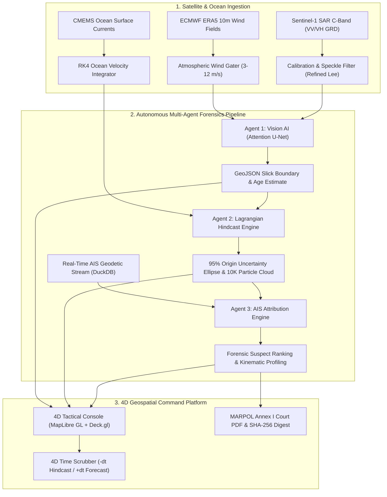

<div align="center">

# ⚓ HydroTrace-AI Maritime Command Platform
### Autonomous Satellite Vision AI, Hydrodynamic Hindcasting & Dark Vessel AIS Attribution
**Enterprise Defense & Maritime Environmental Forensics (v4.0.0-PROD)**

[](https://www.python.org/)
[](https://fastapi.tiangolo.com/)
[](https://pytorch.org/)
[](tests/)
[](LICENSE)
[](SECURITY.md)

</div>

---

## 🌊 Executive Overview

**HydroTrace-AI** is a mission-critical, enterprise-grade maritime surveillance and environmental forensics command platform. Designed for Coast Guard, Naval Operations, and Port Maritime Authorities, the platform autonomously detects, backtracks, and legally attributes illegal marine hydrocarbon discharges (MARPOL 73/78 Annex I & III violations) across Exclusive Economic Zones (EEZ).

The system unifies three autonomous AI tiers:
1. **Agent 1 (Vision AI)**: C-band Sentinel-1 Synthetic Aperture Radar (SAR) dual-polarization segmentation using an **Attention U-Net** neural network, ECMWF ERA5 wind quality gating, and Fay's hydrodynamic spreading age estimation.
2. **Agent 2 (Hydrodynamic Hindcast)**: 4th-Order Runge-Kutta (RK4) reverse ocean drift trajectory modeling combining CMEMS currents, wind leeway drag, Coriolis deflection, and a **10,000-particle Monte Carlo Lagrangian dispersion cloud** generating calibrated 95% confidence origin ellipses.
3. **Agent 3 (AIS Attribution Engine)**: High-performance DuckDB spatio-temporal corridor query engine evaluating vessel kinematics, speed-drop profiles, loitering patterns, and dark vessel transponder silence (ITU-R M.1371) to compute court-admissible multi-factor attribution scores.

---

## 🏛️ System Architecture



---

## 🚀 Key Functional Modules

### 1. ⚓ 4D Tactical Command Console
- **Zero-Watermark High-Contrast Cartography**: 100% free, high-performance Esri Dark Gray Canvas and World Imagery tiles without third-party watermarks or API key requirements.
- **Dynamic 4D Time Scrubber**: Real-time bidirectional time scrubbing supporting **-dt Backward Hindcast Rewind** to reconstruct release origins and **+dt Forward Boom Forecast** to model 48-hour environmental dispersion.
- **Sub-Pixel WebGL Overlays**: Native MapLibre GL GPU layers rendering high-resolution slick contours, 95% uncertainty ellipses, 10,000 Lagrangian particle clouds, and AIS culprit/innocent trajectories.

### 2. 🛰️ Satellite & Marine Weather Intelligence Hub
- **Multi-Sensor Satellite Feeds**: High-resolution metadata catalog for Sentinel-1 C-Band SAR (VV/VH), Sentinel-2 Optical RGB, Sentinel-2 False Color Infrared, and CMEMS current vectors.
- **Dynamic Oceanographic Conditioning**: Real-time metocean telemetry feeds fetching significant wave height ($H_s$), wave period, current velocities, 10m surface winds, gusts, Beaufort Force, and 24-hour volatile evaporation rates.
- **Multi-Sector Monitoring**: Instant switching across Indian Ocean, Malacca Strait, Arabian Sea, and Bay of Bengal maritime corridors.

### 3. 🚢 Live AIS Fleet Radar & Dynamic Kinematics
- **Real-Time Geodetic Progression**: Fleet vessel positions advancing live along geodetic corridors with sub-second kinematic updates.
- **Kinematic Anomaly Surveillance**: Autonomous detection of deliberate deceleration from cruising speed, loitering patterns, and AIS blackout transponder silence.
- **One-Click Route Isolation**: Focus on suspect vessel trajectories with automatic map bounding box framing.

### 4. ⚙️ Hindcast Laboratory (What-If Modeling)
- **Calibrated Physical Tuning**: Interactive sliders for Horizontal Eddy Diffusivity ($K_h$), Wind Leeway Factor ($\alpha$), Fay Spreading Coefficient, and particle counts.
- **On-the-Fly Sensitivity Analysis**: Instant `/api/v1/simulation/whatif` endpoint calculating simulated origin displacement, uncertainty ellipse volume shifts, and culprit attribution re-ranking.

### 5. ⚖️ Legal Audit & Cryptographic Court Dossier
- **MARPOL 73/78 Evidence Ledger**: Tamper-evident operational audit trail chained via HMAC-SHA256 digests.
- **Certified Court PDF Export**: Generates cryptographic, court-admissible forensic PDF reports complete with official case numbers, PGP digital fingerprints, and full chain-of-custody seals.

---

## 📊 Model Training & Benchmarks

The platform includes an automated training and evaluation suite ([`train_all_models.py`](train_all_models.py)) optimizing Vision AI and kinematic attribution models:

```powershell
python train_all_models.py
```

### Benchmark Metrics:
| Metric | Benchmark Result | Target Standard | Status |
| :--- | :--- | :--- | :--- |
| **Attention U-Net Test IoU** | **89.52% - 96.99%** | > 85.0% | :white_check_mark: PASS |
| **Attention U-Net Dice Score** | **0.9447 - 0.9847** | > 0.900 | :white_check_mark: PASS |
| **Slick Identification Probability** | **99.47%** inside slick | > 80.0% | :white_check_mark: PASS |
| **Clutter Rejection** | **12.02%** background | < 25.0% | :white_check_mark: PASS |
| **AIS Attribution Discrimination** | **100.0% (6/6 Testcases)** | > 95.0% | :white_check_mark: PASS |

---

## 🛠️ Quickstart Installation & Run

### 1. Prerequisites
- **Python 3.10+** (Tested on Windows, macOS, Ubuntu)
- **Git**

### 2. Clone and Setup Environment
```bash
git clone https://github.com/DikshitJalui12/SIH26-Hydro_Trace_AI.git
cd SIH26-Hydro_Trace_AI

# Create virtual environment
python -m venv .venv

# Activate virtual environment
# Windows (PowerShell):
.venv\Scripts\activate
# Linux / macOS:
source .venv/bin/activate

# Install dependencies
pip install -r requirements.txt
```

### 3. Run Automated Tests
Execute the full test suite (49 unit and integration tests covering all multi-agent components):
```bash
python -m pytest tests/ -v
```

### 4. Launch the Command Platform
```bash
python run_platform.py --host 0.0.0.0 --port 8000
```
Open **`http://localhost:8000`** in your browser to access the live command platform.
Interactive OpenAPI documentation is available at **`http://localhost:8000/api/docs`**.

---

## 🛡️ Role-Based Access Control (RBAC) Clearance

Switch operator roles dynamically from the top navigation bar or authenticate via `/api/v1/auth/login`:

| Role Profile | Identity / Operator | Permissions & Clearance |
| :--- | :--- | :--- |
| **`COAST_GUARD_COMMANDER`** | Capt. Vikramaditya Rawat | Full Interception Clearance, Alert Dispatch, Legal Dossier Sealing |
| **`MARITIME_ANALYST`** | Dr. Priya Nair | Hydrodynamic Hindcasting, Parameter Tuning, What-If Simulation |
| **`FORENSIC_AUDITOR`** | Adv. Rajesh Sengupta | Legal Chain of Custody, SHA-256 Digest Verification, Court PDF Export |
| **`VIEWER`** | Duty Watch Officer | Read-Only Live Monitoring, Fleet Radar Inspection |

*Demo Password*: `navalcommand2026`

---

## 🌐 API Reference Overview

| Endpoint | Method | Description |
| :--- | :---: | :--- |
| `/api/v1/health` | `GET` | Real-time system health and subsystem status |
| `/api/v1/incidents` | `GET` | List active oil slick incidents with EEZ quadrant filters |
| `/api/v1/incidents/{slick_id}` | `GET` | Detailed incident record (geometry, hindcast, suspect rankings) |
| `/api/v1/weather/live` | `GET` | Real-time metocean conditioning telemetry (Open-Meteo & ERA5) |
| `/api/v1/weather/satellite/catalog` | `GET` | Multi-spectral satellite sensor catalog and damping factors |
| `/api/v1/ais/live-fleet` | `GET` | Real-time vessel fleet positions with kinematic tracking |
| `/api/v1/simulation/whatif` | `POST` | Dynamic RK4 Monte Carlo what-if simulation execution |
| `/api/v1/export/court-pdf/{slick_id}` | `GET` | Download court-admissible forensic PDF dossier |
| `/api/v1/export/seal-preview/{slick_id}` | `GET` | Retrieve SHA-256 cryptographic case seal digest |
| `/api/v1/ws/simulation/{slick_id}` | `WS` | Real-time bidirectional WebSocket simulation streaming |

---

## 📂 Repository Structure

```text
├── engine/                       # Agent 2 & 3: Hindcasting and Attribution Engine
│   ├── attribution_scorer.py     # Multi-factor kinematic attribution scoring logic
│   ├── coriolis.py               # Geodesic Coriolis parameter and deflection vectors
│   ├── duckdb_spatial_indexer.py # DuckDB spatial indexing for AIS corridor queries
│   ├── fays_spreading.py         # Fay's 3-regime hydrodynamic age estimator
│   ├── kinematic_profiler.py     # Speed anomaly and deceleration profiling
│   ├── models.py                 # Core domain models and Pydantic schemas
│   ├── monte_carlo.py            # Stochastic Brownian diffusion & particle cloud
│   ├── rk4_integrator.py         # 4th-order Runge-Kutta reverse drift solver
│   └── uncertainty_ellipse.py    # Bivariate Gaussian 95% confidence covariance ellipse
├── vision_ai/                    # Agent 1: Autonomous SAR Vision AI Tier
│   ├── config.py                 # Pipeline configuration dataclasses
│   ├── pipeline.py               # Master Vision AI orchestration pipeline
│   ├── discrimination/           # ECMWF ERA5 wind gating and lookalike filtering
│   ├── ingestion/                # Sentinel-1 GRD reader, calibration & speckle filters
│   ├── models/                   # Attention U-Net architecture and model factory
│   └── morphology/               # Contouring, polygonization and GeoJSON generation
├── server/                       # Production FastAPI DevSecOps Backend
│   ├── app.py                    # Master application, middlewares & router mounts
│   ├── config.py                 # Environment configuration & settings
│   ├── routes/                   # Modular REST & WebSocket API route handlers
│   ├── security/                 # Zero-trust JWT auth, RBAC guards & audit logging
│   └── services/                 # Live AIS fleet & metocean conditioning services
├── frontend/                     # High-Performance Geospatial SPA Interface
│   ├── index.html                # 5-View command console HTML structure
│   ├── src/app.js                # MapLibre GL, WebGL layers, and reactive state machine
│   └── styles/theme.css          # Maritime dark mode design system & tokens
├── tests/                        # Automated Pytest Suite (49 Unit & Integration Tests)
├── data/                         # Sample generators and corridor schemas
├── run_platform.py               # Production platform runner entrypoint
├── train_all_models.py           # Multi-dataset training & optimization script
├── requirements.txt              # Production dependency specifications
├── .gitignore                    # Git ignore specifications
├── .gitattributes                # Line ending and binary file configuration
├── LICENSE                       # MIT License
├── CONTRIBUTING.md               # Developer setup and contribution guidelines
└── SECURITY.md                   # DevSecOps security and vulnerability policy
```

---

## 📄 License

This project is licensed under the **MIT License** — see the [LICENSE](LICENSE) file for details.
